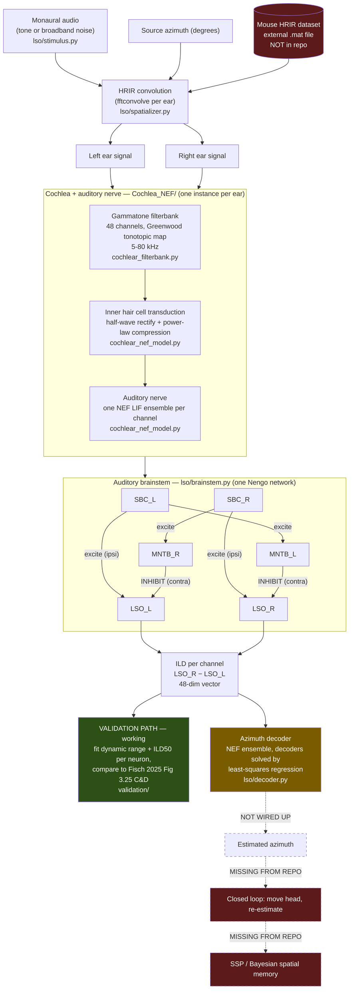

# Project Overview: Biologically Plausible Binaural Sound Source Localization

Orientation doc for picking up this project. Covers what the project is trying to do, how the
code does it, and — importantly — where the committed code diverges from what the August 2026
presentation claims exists.

Written from a read of the repo at commit `025ff84` (branch `main`).
Last verified against the working tree **2026-10-22**. Nothing has been committed since
`d6750aa` (2026-09-15), so sections 3–6 still hold as written; this pass added §2.1 (how the
circuit maps onto the canonical mammalian pathway) and the uncommitted-work note in §5.

For a shorter, biology-light introduction to the pipeline, see `README.md`.

---

## 1. What this project is trying to achieve

Build a **spiking neural network model of how a mouse localizes sound in azimuth**, using only
biologically plausible mechanisms, and show that it reproduces real neurophysiology and real
behaviour.

The specific biological story being modelled is the **ILD (Interaural Level Difference) pathway**:

- A sound off to one side is *louder in the near ear*, because the head casts an acoustic shadow.
  This shadow is only strong at high frequencies — which is why it is the dominant cue for mice
  (mice hear 5–80 kHz and have a head too small for timing cues to work well).
- The brainstem computes this level difference in a specific circuit: cochlea → auditory nerve →
  **spherical bushy cells (SBC)** → the **LSO (Lateral Superior Olive)**, where each side receives
  *excitation from the same-side ear* and *inhibition from the other ear* (routed through the
  **MNTB**, which flips excitation into inhibition).
- So LSO firing rate is effectively a subtraction: `ipsi excitation − contra inhibition`. That
  makes each LSO neuron a level-difference detector, and the population of them encodes azimuth.

### Why do it

Two reasons, and they pull in different directions — worth knowing which one you're being asked
for at any given time:

1. **Neuroscience**: test whether a mechanistic spiking model, built from known anatomy and no
   fitted parameters, actually produces the response properties measured in real LSO neurons.
   This is what the `validation/` directory is for.
2. **Engineering**: biologically-motivated localization is cheap, robust, and works with two
   sensors instead of a microphone array — relevant to autonomous robotics. This is what the
   closed-loop "move and re-estimate" work in the presentation was aiming at.

The modelling framework is the **Neural Engineering Framework (NEF)**, implemented in
**Nengo** (`nengo==4.1.0`). Every stage from the auditory nerve onward is a population of
simulated **LIF (leaky integrate-and-fire)** spiking neurons.

---

## 2. How it works — the pipeline

### Flow diagram



Green = working and actively developed. Amber = code exists but is never called.
Red / dashed = described in the presentation but **not in this repository**.

### Stage-by-stage

| # | Stage | File | What it does |
|---|-------|------|--------------|
| 1 | **Stimulus** | `lso/stimulus.py` | Generates a pure tone or broadband noise burst. `fs = 500 kHz`, 100 ms default — the very high sample rate is needed because mice hear up to 80 kHz. |
| 2 | **Spatialization** | `lso/spatializer.py` | Convolves the mono signal with a left and right **HRIR** (Head-Related Impulse Response) for the requested azimuth. This is what actually injects the ILD cue. 200 azimuth bins at 1.8° steps. |
| 3 | **Cochlear mechanics** | `Cochlea_NEF/cochlear_filterbank.py` | A 48-channel **gammatone filterbank** splits the signal by frequency, mimicking the basilar membrane. Centre frequencies follow the **Greenwood function** (the real cochlear position→frequency map), bandwidths follow ERB. |
| 4 | **Inner hair cells** | `Cochlea_NEF/cochlear_nef_model.py` | Half-wave rectification (hair cells only respond to one direction of deflection) plus power-law compression (the ear's huge dynamic range). Computed offline, before the spiking sim. |
| 5 | **Auditory nerve** | `Cochlea_NEF/cochlear_nef_model.py` | First spiking stage. One NEF `Ensemble` of LIF neurons **per frequency channel**. |
| 6 | **Brainstem circuit** | `lso/brainstem.py` | The core. Builds SBC → MNTB → LSO for both sides as one Nengo network, with the contralateral inhibition wiring shown above. Weights in `lso/config.py` (`w_sbc_lso=1.0`, `w_mntb_lso=1.2` — inhibition slightly stronger than excitation). |
| 7 | **ILD readout** | `lso/brainstem.py`, `lso/results.py` | Two flavours: an NEF-*decoded* scalar difference, and (added more recently) **true per-neuron spike rates in Hz**, probed directly off the LIF neurons. The spike-rate version is the one the validation work uses, because you can compare Hz to a real electrophysiology recording. |
| 8 | **Azimuth decoder** | `lso/decoder.py` | `ICCircularDecoder`: maps the 48-dim ILD vector → (cos θ, sin θ), converted back to an azimuth in 0–360°. **Exists but is never trained or called.** Verified 2026-10-12: the class is never instantiated anywhere in the repo — the only outside reference is one `predict_one` call in `lso/closed_loop.py`, which assumes an already-fitted decoder. |

### 2.1 How this maps onto the real circuit

Useful for orienting against the neuroscience literature, and for seeing what the model leaves out.
The canonical mammalian binaural pathway is:

```
AN → AVCN bushy cells → ┬→ MSO        (ITD — timing cue)
                        ├→ LSO-MNTB   (ILD — level cue)
                        └→ DCN        (spectral cue)
                                       ↓
                                      IC (fusion) → auditory cortex
```

That is: **encoding** (AN) → **feature extraction** (MSO / LSO-MNTB / DCN) → **fusion** (IC) →
**decoding**. Confirmed by reading the code 2026-10-22, the repo maps onto it like this:

| Biological stage | In this repo |
|---|---|
| AN (encoding) | `Cochlea_NEF/` — cochlea → hair cells → auditory nerve |
| AVCN bushy cells | `sbc_L` / `sbc_R` in `lso/brainstem.py` |
| LSO-MNTB (ILD) | `mntb_L/R` + `lso_L/R` — fully wired, correct excitation/inhibition |
| **MSO (ITD)** | ⚠️ `mso.py` only — a standalone prototype, never imported by `brainstem.py` |
| **DCN (spectral)** | ❌ No code anywhere |
| IC (fusion) | The decoder's spiking population is literally named `ic` (`lso/decoder.py:43`) |
| Decoding | The `arctan2` step in `predict_one` (`lso/decoder.py:71`) |

**What this means in practice:** only the ILD pathway feeds `ic`, so despite the name it currently
does single-cue population readout rather than real multi-cue fusion. This is probably deliberate —
ILD is the dominant cue in mice, and that's the project's stated scope — but it's worth asking
Alisa whether `mso.py` was ever intended to eventually feed into `ic`, since the naming suggests
the architecture was designed with that in mind.

---

## 3. "Is this ML?" — the short answer

Sort of, but **not in the way you'd expect**, and this is the single biggest conceptual thing to
get straight before you start.

**There is no gradient descent, no epochs, no loss curve, and no backprop anywhere in this
project.** Almost every parameter is set from biology (measured Greenwood map, measured hair cell
compression, known anatomy of the circuit) rather than learned from data. If you go looking for a
training script you will not find one, and that's by design — the whole scientific claim is
weakened if you fit the model to the data you're trying to predict.

What *is* ML-adjacent:

- **NEF decoder solving.** In the Neural Engineering Framework, when you want a population of
  spiking neurons to represent a value, you fix the neurons' random tuning properties and then
  solve a **regularized least-squares regression** for the output weights ("decoders"). Nengo does
  this automatically for every connection. It is a one-shot closed-form solve, not iterative
  training.
- **The one explicit fit:** `ICCircularDecoder.fit()` in `lso/decoder.py` is the only place the code
  configures this itself — `nengo.solvers.LstsqL2(reg=0.01)`, solving for the ILD→(cos θ, sin θ)
  mapping. Predicting cos/sin instead of the raw angle avoids the 359°/1° wrap-around
  discontinuity; `arctan2` turns the output back into degrees.
- **Curve fitting in validation:** `scipy.optimize.curve_fit` fits sigmoids to LSO rate-vs-ILD
  curves to extract *dynamic range* and *ILD50*, which are then compared to published values.
  That's measurement, not training.

### The steps, in ML terms

| Conventional ML step | What this project does instead |
|---|---|
| Collect dataset | **Generate it** — by sweeping azimuths × random noise seeds, running the full spiking sim for each, and recording `(48-dim ILD vector → true azimuth)` pairs. Each sample costs a full Nengo simulation, so this is slow. **Note:** a `DatasetBuilder` class used to do this, but it was deleted in commit `d6750aa` (2026-09-15); only the `DecoderTrainingData` container (`X`, `angles_deg`) remains, so this step currently has to be rewritten. |
| Data source | A **mouse HRIR/HRTF dataset** — see the warning in §5. Not a standard public set like CIPIC; it's mouse-specific lab data. |
| Model architecture | Fixed by anatomy: 48 channels × (SBC 100 → MNTB 100 → LSO 200 neurons per channel per side). |
| Training | A single least-squares decoder solve. No iterations. |
| Hyperparameters | Synaptic and membrane time constants, connection weights — all in `lso/config.py`, set from biology, tuned by hand if at all. |
| Evaluation — engineering | Mean absolute angular error in degrees, computed with wrap-around (`ICDecoderEvaluator.calculate_circular_errors`, so 359° vs 1° is a 2° error). |
| Evaluation — science | Do model LSO neurons have the same dynamic range and ILD50 as real recorded ones? (`validation/`) — this is the metric that actually matters for the neuroscience claim. |

---

## 4. Gap analysis: presentation vs. repository

This is what you asked for. Presentation slides describe a finished pipeline through active
localization and an SSP derivation; the committed code stops well short of that.

| Presentation claim | Slide | Status in repo | What's needed |
|---|---|---|---|
| HRIR convolution, binaural audio | 3 | ✅ Working | — |
| Cochlear mechanics | 3 | ✅ Working | — |
| Inner hair cells | 3 | ✅ Working | — |
| Auditory nerve (NEF) | 3 | ✅ Working, has a PSTH validation script | — |
| BC / MNTB / LSO circuit | 3 | ✅ Working, most actively developed area | — |
| ILD output | 3 | ✅ Working (both decoded and true spike-rate versions) | — |
| **Azimuth decoder** | 3 | ⚠️ **Code exists, never trained or called** | Updated 2026-09-15 (commit `d6750aa`, alisaslipko) to a full-circle decoder (`ICCircularDecoder`, 0–360°, wrap-aware error). **Re-verified 2026-10-12 — this is now the single blocking gap in the whole pipeline.** The class is never instantiated anywhere; `DatasetBuilder` was deleted in that same commit, so nothing produces the `X_train` / `y_train_deg` that `fit()` requires. Needs: a dataset-generation step (sweep azimuths → `spatializer.spatialize` → `brainstem.run` → collect `ild_neural_tst` vectors), a script that runs fit → evaluate, and a check for front/back confusion (see note below). Everything else downstream — end-to-end azimuth, and now the closed loop — is waiting only on this. Start here. |
| **"Estimated azimuth" end-to-end** | 3, 4 | ❌ **Missing** | Follows directly from the decoder above. |
| **Closed-loop active localization**<br/>(estimate → move → estimate) | 4, 5 | ⚠️ **Code received 2026-09-23, not yet runnable** | **No longer a from-scratch build.** Alisa sent her closed-loop code; stored verbatim at `lso/closed_loop.py`. It provides `circular_diff`, `circular_stats`, `run_single_trial`, `run_experiment`. Mechanism (matches her verbal account): mouse starts at the origin with head angle 0; each step it spatializes noise at the true *relative* angle, decodes an azimuth, turns its head to that prediction, then solves a quadratic for the step length to the next concentric radius along that heading, stopping early if it lands within `0.3 × circle_step` of the source. Three things stand between it and a run: (1) **the decoder is untrained** — see the row above, this is the real blocker; (2) it was lifted out of a notebook, so `np`, `stimulus_gen`, `spatializer`, `brainstem` and `decoder` are undefined at module level; (3) the snippet is **truncated** — `report(...)` arrived as a bare signature with no body, so the aggregation/stats step is still missing. Its API calls, though, do line up with current code (verified 2026-10-12: `predict_one` at `lso/decoder.py:64`, `ild_neural_tst` at `lso/results.py:62`, computed at `lso/brainstem.py:191`), so no adaptation is needed there. Note its defaults are `n_trials=200`, `n_circles=5`, `circle_step=1.25` — 200 trials, not the 50 the slides describe. |
| **Statistics table** (median error 8.14° → 2.01°, n=50 per stage) | 4 | ❌ **Still missing** | Note the trap: `lso/results.py` is *not* a results/statistics script — it's a plain dataclass holding one simulation's outputs. **Update 2026-09-23:** the `report()` function in Alisa's `lso/closed_loop.py` is almost certainly what produced this table (it would call `circular_stats` per circle — which computes exactly the slide's quantities: n, resultant length r, mean angle, and the median absolute error of "oriented" trials, i.e. those within ±90°). But its body was cut off from the snippet we received, so **ask Alisa for the rest of `report()`** rather than rebuilding it. The n=50 vs the script's `n_trials=200` default also needs reconciling. |
| **The simulator screenshot** (head angle, true/est. relative angle, distance to source, concentric target radii) | 4 | ❌ **Missing** | That's a whole visualization/agent harness that isn't committed. |
| **SSP representation + Bayesian fusion** | 5, 6 | ❌ **Missing entirely** | Confirmed absent: no `ssp`/`bayes`/`spatial semantic` match in any `.py` file (the one hit in `lso/main.ipynb` is a false positive inside base64 image data). No `nengo_spa` or `sspspace` in `requirements.txt`. The slide says "work done: mathematical derivation" — so this may only ever have existed as written math, never as code. |

**Front/back note on the circular decoder.** ILDs are nearly the same for mirror-image positions
in front of and behind the interaural axis (e.g. 30° and 150°). If the 48-channel ILD vector can't
separate them, the least-squares fit averages their (cos θ, sin θ) targets and predictions collapse
toward the side (≈90° / 270°). Mouse head filtering varies across frequency, so the channels *may*
carry enough spectral difference to disambiguate — untested. A predicted-vs-true plot over the
full circle will show a mirrored pattern if not.

### What's in the repo but *not* in the presentation

Worth knowing, because it's where the recent effort actually went:

- **`validation/` — Fisch (2025) reproduction.** The most active work, and **the one part of the
  project with real results in hand.** `plot_population.py` reproduces Fig. 3.25 C&D, comparing
  model dynamic range and ILD50 against hardcoded reference values from 13 real neurons.
  `run_within_channel_population.py` does a per-neuron population analysis in channel 24 — it has
  been run, and its output is committed as `population_results_ch24.csv` (200 neurons) and
  `fig_c_d_ch24_neurons.png`:

  | metric | model (ch24, n=200) | Fisch real (n=13) |
  |---|---|---|
  | dynamic range, TST | 32.13 ± 5.10 | 40.4 ± 16.6 |
  | dynamic range, onset | 20.09 ± 11.75 | 17.5 ± 0.9 |
  | ILD50, TST | 23.03 ± 5.91 | 10.9 ± 15.2 |
  | ILD50, onset | 22.73 ± 8.11 | 1.6 ± 0.9 |

  **Dynamic range reproduces Fisch well** — both means fall within 1 SD of the real values, and the
  TST > onset *direction* is correct. **ILD50 does not:** the model shows essentially no TST→onset
  shift (23.03 → 22.73) where Fisch sees a large one (10.9 → 1.6). That discrepancy is the main
  open scientific question on this thread. Two caveats on the comparison: the model SDs are much
  tighter than Fisch's because these are 200 neurons sharing one CF, whereas his n=13 span
  different CFs; and there is no trial-averaging yet (Fisch repeats each ILD ten times), which is
  paused pending Bryan's read on whether those repeats feed his rate estimates.
- **`lso/level_difference_wrapper.py`** — `LSOWrapper` adapts the full spiking model to the same
  interface as the synthetic `MockNeuron`, so one set of fitting code runs against both.
- **`mso.py`** — a standalone prototype of the *other* localization pathway (MSO / interaural
  **time** difference, after Grothe et al. 2010). Not connected to anything. Exploratory.
- **`validation/minimum_audible_angle.py`** — a scaffold for reproducing Behrens & Klump (2016)
  mouse behavioural data, but it currently runs against a `MockModel` that just returns
  `true_angle + gaussian noise`. Not yet connected to the real model.

---

## 5. Practical warnings before you run anything

**The HRIR dataset question is settled (2026-10-23).** The repo is now self-contained: the
bundled dataset lives at `data/hrir_fixed_dataset.npz` and `lso/hrir.py` loads it by default, so
nothing depends on an external path any more. `lso/main.ipynb` uses it; the older `ild-be.ipynb`
still points at the untracked `../hrtf/*.mat` and should be treated as historical.

**Provenance.** The source is [figshare article 11691615](https://figshare.com/articles/dataset/Mouse_Head_Related_Transfer_Function_processed_data/11691615)
(Ito, Si, Feldheim & Litke — HRTFs of 3 female CBA/CaJ mice). Its three `.mat` files are three
different *animals*, not variants; this project uses `2018-08-15`, reading the variable
`allimps_reflect` — which is **not** documented on the dataset page, and is worth asking Alisa
about. The bundled `.npz` is derived from that file: right-ear data only, left ear produced by
mirroring. Verified directly — left is an *exact* azimuth-mirror of right (cosine similarity
1.0000), so it holds no genuine left-ear measurement and is perfectly symmetric. Fine for
exploration; prefer the real `.mat` (~870 MB) for decoder training, where genuine left/right
asymmetry may be what disambiguates front from back.

**Array layout is confirmed**, from the authors' own `Demo_PlotHRTFs.m`: `(ear, elevation,
azimuth, time)` with ear 0 = left, elevation 0 = the 0° horizontal plane, 200 azimuths at 1.8°.
That makes `lso/spatializer.py` and `config.elevation_idx = 0` both correct. `ild-be.ipynb` has
the ears swapped and uses elevation 5, so any figure from it is mirrored.

**`Fisch2025.pdf` is referenced but absent.** `validation/plot_population.py` cites it in a
comment. It's on the lab Zotero group. There are also other reference PDFs (a broader lab reading
list) the project was built against — not yet identified individually. Ask Shriya/Alisa which ones
before adding any, since "the PDFs we referred to" wasn't enumerated.

**Resolved 2026-10-23 (Phase 2).** The dataset now lives at `data/hrir_fixed_dataset.npz` and is
loaded by `lso/hrir.py`, the stray `lso/-` is gone, `.gitignore` excludes `__pycache__/`, and the
previously untracked handoff material (`OVERVIEW.md`, `README.md`, `lso/closed_loop.py`) is
committed. See `PROGRESS.md`.

---

## 6. Suggested reading order

1. `lso/config.py` — every parameter in one place, well commented. Start here.
2. `lso/brainstem.py` — the actual circuit; this is the heart of the project.
3. `Cochlea_NEF/cochlear_filterbank.py` — the front end, and self-contained enough to run alone.
4. `validation/level_difference_coding.py` + `validation/plot_population.py` — the science claim
   and how it's being tested.
5. `lso/decoder.py` — the unused piece, recently updated to a full-circle decoder, and the most likely
   next thing to need your attention.

### Where the gaps probably lead

Updated 2026-10-12. The shape of the remaining work changed once Alisa's closed-loop code arrived:
the gaps now form a single chain, not three independent builds.

- **Cheapest:** make the repo self-contained by wiring in `hrir_fixed_dataset.npz`.
- **The one real blocker:** rebuild the dataset-generation step and train `ICCircularDecoder`, then
  find out whether the azimuth decoder works — including whether it can tell front from back.
  Both end-to-end azimuth *and* the closed loop are waiting only on this one piece.
- **Then the closed loop mostly falls out.** With a trained decoder, `lso/closed_loop.py` needs
  only its imports wired up and the missing `report()` body (ask Alisa) — not a rebuild.
- **Still genuinely absent:** the SSP / Bayesian memory layer, and the simulator visualization.
  For SSP the slide itself says only "mathematical derivation," so it may never have been code.
  Worth asking Bryan before assuming either exists somewhere uncommitted.
- **Parallel track, independent of all the above:** the Fisch validation in `validation/`, where
  the open item is the ILD50 discrepancy (see section 4) — likely a question for Bryan before it's
  a question for code.
